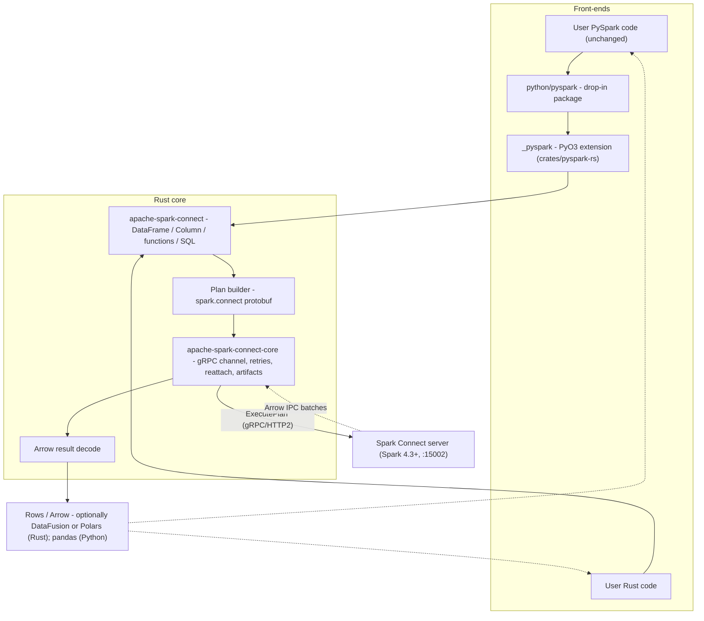
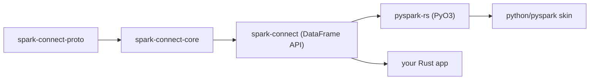
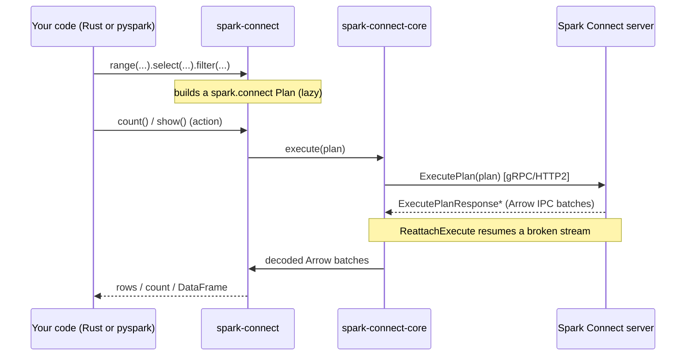
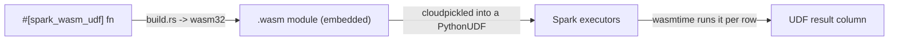

# Architecture

**One protocol, one Rust core, two front-ends.** This project reimplements the
Spark Connect *client* - plan building, gRPC transport, and Arrow result decoding
- in Rust, and exposes it both as a native Rust library and, through PyO3, as a
drop-in `pyspark` package.

## The one big idea

A Spark Connect client does three things: it **builds a protobuf plan** from your
DataFrame/SQL operations, **sends it over gRPC** to a Spark Connect server, and
**decodes the Arrow result** the server streams back. The reference client does
all three in Python.

Here, those three jobs live in Rust crates. On top of that core sit two thin
front-ends that share it: a synchronous **Rust API** shaped like PySpark, and a
**`pyspark` Python package** (a PyO3 extension) that is byte-for-byte compatible
with the reference client. Same `spark.connect` protocol, same server, same
results.

## End-to-end picture



Everything below the front-ends is shared: the Python package doesn't
reimplement anything the Rust API doesn't already do - it calls straight into the
same core through the `_pyspark` extension.

## The crates

A Cargo workspace of library crates, plus a Python skin:

| Component | Path | Responsibility |
|---|---|---|
| `apache-spark-connect-proto` | `crates/spark-connect-proto` | Generated `spark.connect.*` gRPC/protobuf types |
| `apache-spark-connect-core` | `crates/spark-connect-core` | Transport: channel, retries, reattach, artifacts, errors |
| `apache-spark-connect` | `crates/spark-connect` | The DataFrame API: session, dataframe, column, functions, plan, group, catalog, window, readwriter, streaming, types |
| `pyspark-rs` | `crates/pyspark-rs` | PyO3 bindings - builds the `_pyspark` extension module |
| Python skin | `python/pyspark` | The drop-in `pyspark` package (+ vendored `pyspark.pandas`, `cloudpickle`, `pyspark.testing`) |



## A query's lifecycle

When you call an action such as `count()` or `show()`, the lazily-built plan is
serialized and sent to the server; results stream back as Arrow batches.

Day-time intervals use signed 64-bit microseconds in Rust (`Value::DayTimeInterval`)
and Python `datetime.timedelta` values. `createDataFrame` supports inferred and
explicit interval schemas, including nested structs, lists, maps, and nulls.
Collected rows can be passed back with their schema. As in PySpark, an `int` or a
`float` for an interval field is taken as microseconds, and a value outside the signed
64-bit microsecond range is an error.



Transformations are **lazy** - they only build up the plan. Only an *action*
triggers `ExecutePlan`. If the response stream breaks mid-flight, or the server
ends it before the result is complete (as it does after
`spark.connect.execute.reattachable.senderMaxStreamDuration` or
`senderMaxStreamSize`), the core's reattachable-execute iterator resumes from the
last response it saw, so long results survive transient disconnects. Like the
reference client, it releases each response it has read, and the whole execution
once the result is complete, so the server does not keep them.

`spark.sql()` is the exception, as in the reference client: it sends the
statement at once. A command such as `CREATE VIEW` or `SET` takes effect there,
and its DataFrame holds the result the server returned; a statement that does not
parse or resolve fails there. A query's DataFrame still runs at an action.

Each plan node gets its plan ID once, the first time it is sent, and keeps it, as
in the reference client. Re-executing a DataFrame therefore sends the same
relation, and a DataFrame built on another keeps that input's plan IDs, so the
server's per-session plan cache (`spark.connect.session.planCache.*`) can reuse
the plans it already resolved instead of resolving them again. As with the
reference client, a re-executed DataFrame can then use its earlier resolution.
A DataFrame from `spark.read.parquet(path)`, for example, keeps the file listing
it resolved: once the files under `path` are overwritten, running it again fails
with `FAILED_READ_FILE.FILE_NOT_EXIST`, while a new `spark.read.parquet(path)`
reads the new files. Setting `spark.connect.session.planCache.enabled` to `false`
turns the cache off, on the server or for a session with `spark.conf.set`.

### Python Arrow table handoff

`toArrow()` collects decoded batches and uses arrow-rs's `IntoPyArrow` for one
boxed `RecordBatchReader`. Compatible value and offset buffers are shared;
network decoding, sliced validity bitmaps, and pandas conversion may still copy.
Batch schema consistency is validated before export. Field names or timezones
containing NUL use IPC over the collected batches, without another RPC. Empty
batch vectors retain the empty-schema behavior.

`createDataFrame(pyarrow_table)` uses the reverse boundary: Spark's schema and
timestamp conversion helpers normalize the table, then arrow-rs imports its
`RecordBatchReader` through the C Stream interface. The Rust core serializes
those batches to IPC for the local relation sent to Spark. No Python rows are
materialized; casts, buffer alignment, and IPC serialization may still copy.
Empty tables require an explicit schema, matching PySpark Connect.
Pandas inputs with only NumPy `int64` or pandas nullable `Int64` columns also
use this importer, preserving integer precision and null masks without Python
rows. Small frames (fewer than 1,000 rows) with only NumPy columns retain the
row path to avoid the configuration RPC of the importer; nullable `Int64` columns
use Arrow at any size.
This initial path accepts inferred schemas, complete string column names,
and explicit `StructType` schemas whose fields are all `LongType`. Other dtypes,
DDL/atomic schemas, schema conversions, NUL names, and duplicate/non-string input names
retain the existing row conversion path. `verifySchema` remains ignored for
pandas Arrow input, matching Spark Connect.
Pandas frames of at least 100,000 rows whose columns are all NumPy `float64`,
with an explicit `StructType` of `DoubleType` fields, are encoded to Arrow IPC
from their columns, with pandas' missing values as nulls, and sent inline as the
row path sends them, without the importer's configuration RPC.
Pandas object columns containing exact `datetime.date` values or `None` use the
Arrow importer at 10,000 rows or more with an explicit `StructType` of `DateType`
fields. Unsupported values and customized inputs retain the row conversion path.
Inputs at or above `spark.sql.session.localRelationCacheThreshold` are serialized
into independent IPC streams and uploaded as session-scoped cache artifacts.
The plan carries `ChunkedCachedLocalRelation` hashes instead of embedding the
entire payload. Spark infers omitted schemas from the Arrow streams; explicit
schemas travel in the local relation or a separate schema artifact.
Chunk sizes, upload batch sizes, and the total relation size
limit follow the server's local-relation settings; artifact RPC messages use
32 KiB pieces, with SHA-256 deduplication and CRC checks.

## Two front-ends, one core

=== "Rust (native)"

    ```rust
    use spark_connect::{SparkSession, functions as f};

    let spark = SparkSession::builder()
        .remote("sc://localhost:15002")
        .get_or_create()?;
    spark.range(100)?.select([f::col("id")]).show(20)?;
    ```

=== "Python (drop-in)"

    ```python
    from pyspark.sql import SparkSession, functions as sf

    spark = SparkSession.builder.remote("sc://localhost:15002").getOrCreate()
    spark.range(0, 100).select(sf.col("id")).show(20)
    ```

Both paths build the *same* protobuf plan through the *same* Rust core and get
the *same* Arrow results back. The Python package is a compatibility skin over
`pyspark-rs`; it does not fork or reimplement the client logic.

## Rust UDFs on the executors

Beyond the client, a Rust function can be compiled to WebAssembly and run as a
Spark UDF **on the executors** - shipped inside a standard `PythonUDF` and
executed with `wasmtime`, so nothing Rust-specific is needed server-side.



See [Rust UDFs via WebAssembly](udfs.md) for the full story.

## Design principles

1. **Don't fork PySpark's semantics** - mirror the public API and match the
   reference client's protobuf output, verified by golden-proto tests.
2. **One core, thin front-ends** - the Python package adds no client logic the
   Rust API doesn't already have.
3. **Correctness is gated in CI** - golden-proto tests guard plan building; the
   official Apache Spark Connect test suite guards transport and Arrow paths (see
   the CI notes under `dev/design/`).
4. **Version = Spark version** - the crate/wheel version tracks the Spark release
   it targets, so the number tells you which Spark it speaks.

For the deeper design write-ups (design notes, CI, the official test suite, and
acceptance criteria), see [`dev/design/`](https://github.com/apache/spark-connect-rust/tree/master/dev/design)
in the repository.
